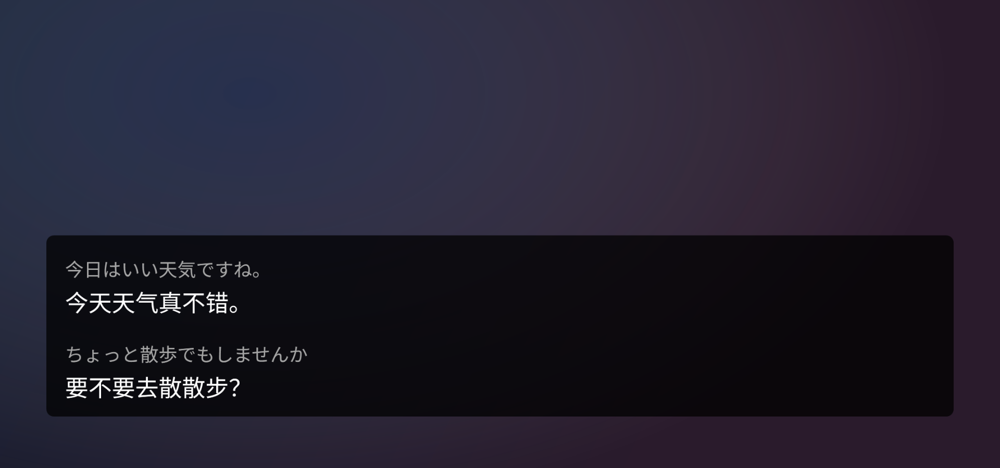
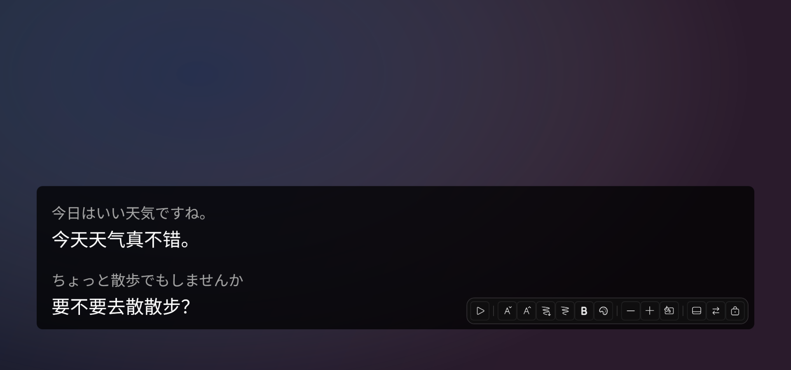
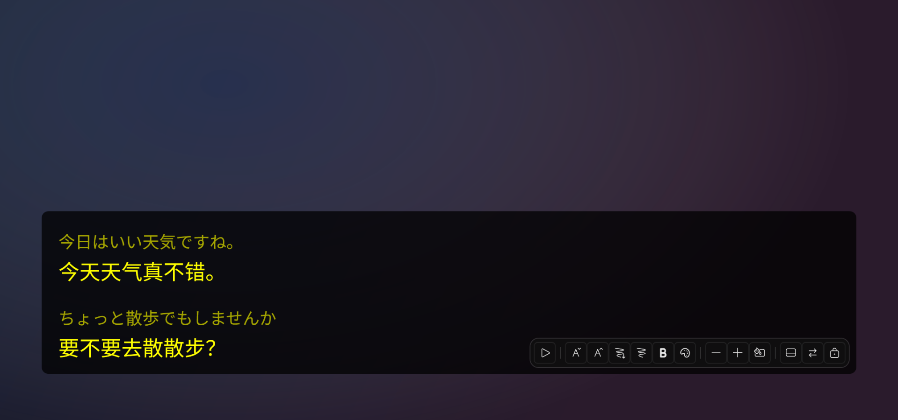

<div align="center">


# LiveCaptions Translator — Fork Edition

**Real-time audio/speech translation based on Windows LiveCaptions, with a rewritten caption display pipeline.**

[](https://www.microsoft.com/en-us/software-download/windows11)
[](https://github.com/Arkueid/LiveCaptions-Translator/blob/master/LICENSE)

**English** | [中文](README_zh-CN.md)

</div>

This repository is a fork of **[SakiRinn/LiveCaptions-Translator](https://github.com/SakiRinn/LiveCaptions-Translator)** — go there for the original project, its [releases](https://github.com/SakiRinn/LiveCaptions-Translator/releases) and its [wiki](https://github.com/SakiRinn/LiveCaptions-Translator/wiki). Everything about Windows LiveCaptions setup and the supported translation APIs (Ollama, OpenAI-compatible, OpenRouter, Google, DeepL, Youdao, Baidu, MTranServer, LibreTranslate) is inherited unchanged.

What is different here is **how captions are displayed and controlled**. That is what this README covers.

## Preview

Captions live in a transparent overlay that opens with the app; the source line is dimmed, the translation is brighter:

<p align="center">
  
</p>

Hovering the overlay fades in a compact toolbar — pause, font size, bold, outline, text color, background opacity and color, what to show, line order, copy-safe click-through:

<p align="center">
  
  <br>
  
</p>

> The backdrop is illustrative; the overlay itself (box, text, toolbar) is rendered by the actual UI code.

## What This Fork Changes

- **Captions that never rewind.** Windows LiveCaptions keeps rewriting the sentence it is still hearing. Instead of painting that raw stream, a stabilizer commits text monotonically: what you have read never disappears or moves, and only the still-changing tail waits for ~0.2 s of silence before it is shown.
- **One identity per sentence.** Every finished sentence gets a sequence number; a translation is attached to that number instead of being matched by fuzzy string comparison. This removed the duplicated and swallowed sentence groups of the old display.
- **Finished sentences go first.** Only one translation request is in flight at a time (local models degrade badly when requests pile up). When a sentence finishes, the speculative translation of the still-growing sentence is cancelled so the model starts on text the reader will actually keep.
- **One snapshot per frame.** The overlay paints a single immutable snapshot per update, instead of a handful of display properties written one after another from different threads.
- **All controls live on the overlay.** Pause, font size, bold, outline, text/background colors, opacity, what to show (both / translation only / source only), line order and click-through are in the hover toolbar. `Ctrl+Alt+T` restores input after click-through. Style buttons take effect immediately.
- **Latency readout.** With *Show Latency* on, each translation is prefixed with its duration plus the model-side prefill/decode split (e.g. `1420 ms (380+1040)`).
- **Ollama fixes.** Requests send `temperature` / `num_predict` (the previously sent `max_tokens` was ignored) and thinking is disabled for Qwen 3.5.

### Removed compared to upstream

- The caption page and Log Cards in the main window — captions are overlay-only now.
- The pause button in the main window title bar — pause lives on the overlay toolbar.
- The parallel/queued translation task queue — a single in-flight request with preemption instead.

## Building from Source

This fork does not publish binaries:

```bash
git clone https://github.com/Arkueid/LiveCaptions-Translator.git
cd LiveCaptions-Translator
dotnet build -c Release
```

Run `bin/Release/net8.0-windows/LiveCaptionsTranslator.exe`. Building needs the [.NET 8 SDK](https://dotnet.microsoft.com/download/dotnet/8.0).

## First Run

Same as upstream: make sure Windows LiveCaptions works (`Win + Ctrl + L`), set its **Position** to *Overlaid on screen*, pick your API and target language in the settings page — details in the [upstream wiki](https://github.com/SakiRinn/LiveCaptions-Translator/wiki).

## Credits & License

- Original project and all the heavy lifting: [@SakiRinn](https://github.com/SakiRinn) and [contributors](https://github.com/SakiRinn/LiveCaptions-Translator/graphs/contributors).
- Fork maintained by [@Arkueid](https://github.com/Arkueid).
- Licensed under the [Apache License 2.0](LICENSE), same as upstream.
